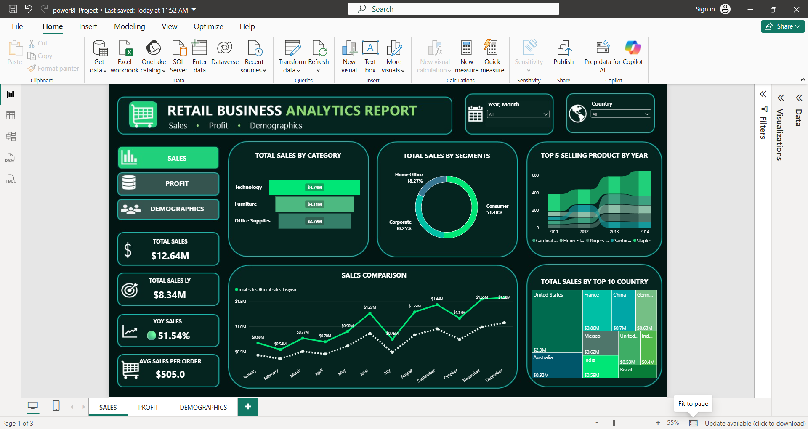
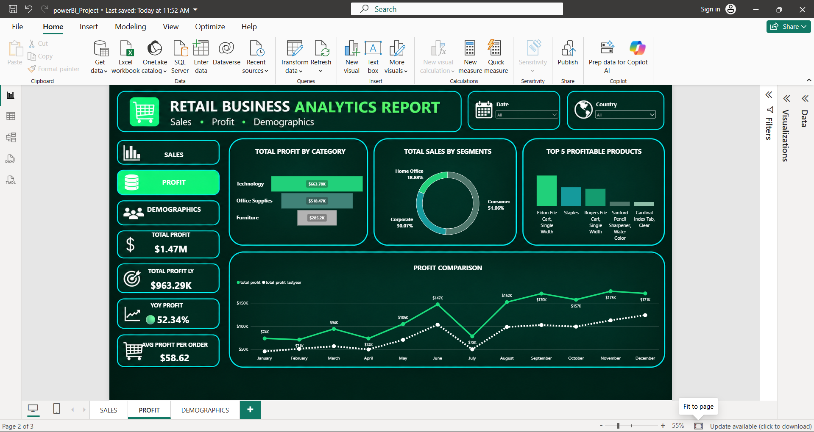
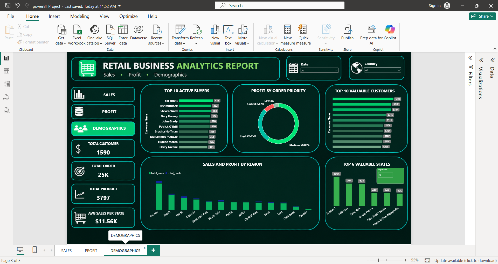

# Power BI Sales Dashboard

## Project Overview

This project presents an interactive Retail Business Analytics Dashboard developed using Microsoft Power BI to analyze sales performance, profitability, and customer demographics.

## Dashboard Screenshots

### 1. Sales Dashboard

### 2. Profit Dashboard

### 3. Demographics Dashboard

## Dashboard Pages

- **Sales Analysis:** Sales by category, customer segment, country, and product trends.
- **Profit Analysis:** Insights into business profitability and performance.
- **Demographics Analysis:** Customer and demographic insights.

## Key Features

- Interactive Year and Month slicer
- Country filtering
- Sales and year-over-year performance KPIs
- Category, segment, and product analysis
- Interactive charts and KPI cards

## Tools Used

- Microsoft Power BI Desktop
- Data visualization and dashboard design
- Data analysis

## Project Files

- **Original Power BI Report:** [powerBI_Project.pbix](powerBI_Project.pbix)
- **PDF Dashboard Preview:** [powerBI_Sales_Profit_Demographics.pdf](powerBI_Sales_Profit_Demographics.pdf)

## Author

**Vismaya**
